<h1 align="center">Olá! Eu sou o Higor Santos</h1> <h3 align="center">Estudante de Análise e Desenvolvimento de Sistemas na UNICID, com foco em desenvolvimento web e sistemas para pequenos negócios.</h3> 
 Desenvolvo aplicações web que resolvem problemas reais do dia a dia de barbearias, salões e outros negócios de serviços, do código até a apresentação para o cliente. 
 
 Uso o GitHub para organizar meus projetos e registrar a minha evolução. Trabalho com HTML, CSS, JavaScript, Python e Firebase, e estou em busca da minha primeira oportunidade na área de tecnologia. 
 
   
 <h2 align="center">Tecnologias e ferramentas</h2> 
  
 <h2 align="center">Projetos em destaque</h2> 
 <b>Sistema de agendamento online</b>  Sistema completo para barbearias e salões, com bloqueio de horários em tempo real, grade configurável por dia, cancelamento por código, escolha de vários serviços com cálculo automático do total e agendamento para mais de uma pessoa.  <i>HTML, CSS, JavaScript, Firebase (Firestore e Authentication), Cloudinary e Netlify</i> 
 
 <b>CINEindex</b>  Plataforma de avaliações de filmes desenvolvida na faculdade, com planos de assinatura (Curioso e Crítico), página de planos e página de perfil com avaliações, lista pessoal e ranking.  <i>HTML e CSS</i> 
 
 <b>ALUNEA</b>  Branding e conteúdo para uma marca de beleza, com carrosséis de Instagram gerados com Python e uma identidade visual minimalista, inspirada em cosméticos de luxo.  <i>Python (Pillow)</i> 
 
  
 <h2 align="center">Formação</h2> 
 Análise e Desenvolvimento de Sistemas, UNICID (em andamento)  Crie um site simples usando HTML, CSS e JavaScript, Fundação Bradesco | Escola Virtual  Scratch, suas extensões e computação física, Fundação Bradesco | Escola Virtual  Inglês intermediário (conversação e escrita) 
 <h2 align="center">Estatísticas do GitHub</h2> 
   
 <h2 align="center">Contribuições</h2> 
 <picture> <source media="(prefers-color-scheme: dark)" srcset="https://raw.githubusercontent.com/higor44santos-png/higor44santos-png/output/pacman-contribution-graph-dark.svg" /> <source media="(prefers-color-scheme: light)" srcset="https://raw.githubusercontent.com/higor44santos-png/higor44santos-png/output/pacman-contribution-graph.svg" />  </picture> 

